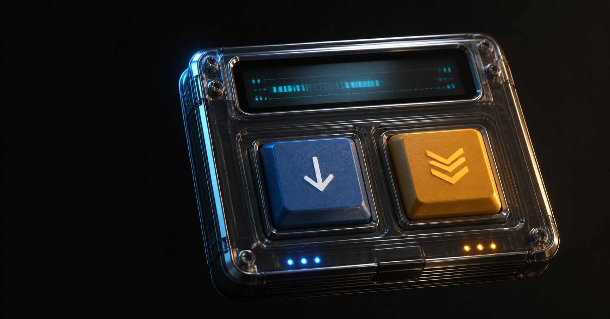

<p align="center">
  
</p>

# Ramin Station

A tactile retro desktop media toolkit for downloading media and preparing video files. It wraps FFmpeg and yt-dlp in a focused interface inspired by physical media decks, translucent hardware, and early desktop players.

[Website](https://raminpiri.ir/station) · [Latest release](https://github.com/raminpiri/ramin-station/releases/latest) · [Report a bug](https://github.com/raminpiri/ramin-station/issues)

> Version 1.0 is an unsigned personal release for macOS and Windows. Read the platform notes before installing.

## Features

- Download video as MP4 at 1080p, 720p, or 480p.
- Extract audio as MP3 at source, 256K, or 128K quality.
- Save downloads directly to the user's `Downloads` folder.
- Retry YouTube downloads with Chrome, Edge, Firefox, Safari, or a Netscape `cookies.txt` file.
- Compress one file or a complete folder to HEVC/H.265 using High, Balanced, or Tiny presets.
- Create large, edit-friendly ProRes Proxy MOV files with **Decompress / Edit Fast**.
- Install app-managed copies of FFmpeg, yt-dlp, and Deno when required.
- Show progress and logs inside the built-in retro terminal.
- Cancel active download and transcode jobs.
- Use native `Command+V` and `Ctrl+V` clipboard paste.

## Download and install

Download the appropriate package from [GitHub Releases](https://github.com/raminpiri/ramin-station/releases/latest).

### macOS

1. Download `Ramin-Station-1.0-macOS.dmg`.
2. Drag **Ramin Station** into Applications.
3. Because V1 is not notarized, Control-click the app and choose **Open** on first launch.

The macOS app supports Apple Silicon and Intel and targets macOS 13 or newer.

### Windows

- Use `Ramin-Station-1.0-Windows-Setup.exe` for a normal per-user installation.
- Use `Ramin-Station-1.0-Windows-Portable.zip` if you prefer a portable copy.

Windows SmartScreen may display **Unknown Publisher** because V1 is not code-signed.

## YouTube cookies

Ramin Station first tries a public download. If YouTube asks for authentication, **Auto Retry** tries supported browser cookies. Safari may require:

1. Open **System Settings → Privacy & Security → Full Disk Access**.
2. Add Ramin Station and reopen the app.

If browser-cookie access is unavailable, export a Netscape-format `cookies.txt` file and select it inside the app. Never attach cookie files to GitHub issues or share them with anyone. Some YouTube videos may still require upstream yt-dlp PO-token support.

## Build from source

### macOS packages

Requirements: macOS, Xcode Command Line Tools, Swift 5, and Go 1.23 or newer.

```bash
zsh app/native/build-macos.sh
zsh app/windows/build-windows.sh
```

Both commands place their output in `dist/`. The Windows build script cross-compiles the x64 executable and installer from macOS.

### Windows packages on Windows

Requirements: PowerShell and Go 1.23 or newer.

```powershell
powershell -ExecutionPolicy Bypass -File app/windows/build-windows.ps1
```

### Browser prototype

The browser prototype is intended for UI development and expects system-installed tools.

```bash
node app/server.js
```

Then open `http://127.0.0.1:3186`.

## Project structure

```text
app/
├── assets/              Shared visual and audio assets
├── native/              Native macOS wrapper and packaging script
├── windows/             Native Windows wrapper, installer, and packaging scripts
├── index.html           Main tactile deck
├── download.html        Download workflow
├── compress.html        Compression and edit-ready workflow
├── tool.js              Shared UI behavior and native bridge
└── server.js            Local browser prototype
```

## Automated releases

Every pushed tag matching `v*` runs the GitHub release workflow. It builds all four packages, generates `SHA256SUMS.txt`, and creates a GitHub Release.

```bash
git tag v1.0.0
git push origin v1.0.0
```

## Responsible use

Only download media you own or have permission to save. You are responsible for complying with copyright law and each platform's terms of service.

FFmpeg, yt-dlp, and Deno are downloaded from their upstream release pages and are not bundled with Ramin Station. Third-party license texts for compiled Windows dependencies are included under `app/licenses/`.

## License

Ramin Station is currently distributed under a personal-use, source-available license. It is not an OSI-approved open-source license. See [LICENSE](LICENSE).

Copyright © 2026 Ramin Piri.

